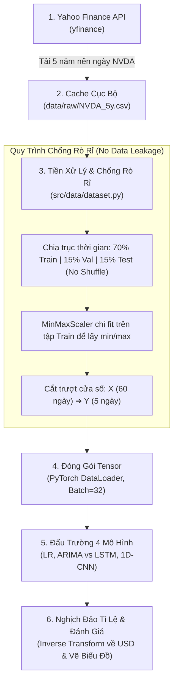

# DESIGN: THIẾT KẾ HỆ THỐNG & QUY TRÌNH KỸ THUẬT

Tài liệu thiết kế kiến trúc mô hình, cấu trúc thư mục, luồng dữ liệu và quy trình huấn luyện cho bài toán dự đoán giá cổ phiếu `NVDA`.

---

## 1. System & Model Architecture (Kiến trúc hệ thống & Mô hình)

Dự án thiết kế một đấu trường đối chứng giữa 2 trường phái: **Toán thống kê truyền thống** và **Học sâu (Deep Learning)** để kiểm chứng giá trị thực tế của AI trên chuỗi giá cổ phiếu `NVDA`.

```text
[Đầu vào: 60 ngày giá đóng cửa quá khứ]
   │
   ├──► 1. Linear Regression : Kẻ đường thẳng hồi quy nối 60 ngày cũ sang 5 ngày mới.
   │                           (Làm mốc tối thiểu: Nếu AI không thắng nổi mô hình này thì AI vô nghĩa).
   │
   ├──► 2. ARIMA(p, d, q)    : Phân rã chuỗi giá thành yếu tố tự hồi quy (AR), sai phân (I) và trung bình trượt (MA).
   │                           (Làm mốc học thuật kinh điển cho chuỗi thời gian).
   │
   ├──► 3. Vanilla LSTM      : Mạng nơ-ron hồi quy có các cổng nhớ (Forget, Input, Output Gates).
   │                           Nhớ lại các nhịp sóng dài hạn trong 60 ngày để dự phóng 5 ngày tới.
   │                           Cấu hình: 2 tầng LSTM (hidden_dim=64, dropout=0.2) + 1 tầng Linear ra 5 giá trị.
   │
   └──► 4. 1D-CNN            : Dùng các bộ lọc tích chập (Kernel Size = 3) trượt dọc theo chuỗi thời gian.
                               Trích xuất các mẫu hình nến cục bộ (ví dụ: đáy đôi, đỉnh nhọn) cực nhanh.
                               Cấu hình: 2 tầng Conv1d + BatchNorm1d + ReLU + MaxPool1d + Linear ra 5 giá trị.
   │
[Đầu ra: Dải 5 ngày giá đóng cửa liên tiếp]
```

---

## 2. Modules & Folder Structure (Cấu trúc thư mục & Phân hệ)

Toàn bộ dự án được tổ chức gọn gàng, module hóa rõ ràng theo chuẩn công nghệ phần mềm:

```text
Stock-Forecasting/
├── config/
│   └── default_config.yaml         # Tệp cấu hình tập trung (mã NVDA, lookback 60, horizon 5, epochs, batch_size)
│
├── data/
│   ├── raw/                        # Nơi lưu trữ file cache CSV tải từ Yahoo Finance (loại khỏi Git)
│   └── processed/                  # Nơi lưu mảng dữ liệu sau khi scale và cắt trượt cửa sổ
│
├── docs/                           # Sổ tay hướng dẫn chuyên sâu (EDA, kiểm định dừng, kỹ thuật huấn luyện)
├── notebooks/                      # Jupyter Notebooks phục vụ vẽ biểu đồ và phân tích dữ liệu nhanh
│
├── outputs/
│   ├── runs/<run_id>/              # Lưu vết từng lần chạy (checkpoints weights .pt, file log môi trường)
│   └── published/                  # Lưu ảnh biểu đồ và bảng kết quả chính thức dùng cho báo cáo
│
├── scripts/                        # Các lệnh điều phối thực thi trực tiếp từ dòng lệnh (CLI)
│   ├── train.py                    # Script chạy huấn luyện mô hình học sâu
│   ├── eval.py                     # Script chạy đánh giá và so sánh kết quả 4 mô hình
│   └── predict.py                  # Script nạp mô hình tốt nhất để dự đoán 5 ngày tiếp theo
│
├── src/                            # Thư viện mã nguồn cốt lõi (tái sử dụng được)
│   ├── data/
│   │   ├── data_loader.py          # Kéo dữ liệu nến từ yfinance và lưu trữ cache cục bộ
│   │   └── dataset.py              # Chia tập 70/15/15, fit scaler và tạo PyTorch DataLoader
│   ├── models/
│   │   ├── baseline_lr.py          # Cài đặt mô hình Linear Regression
│   │   ├── baseline_arima.py       # Cài đặt mô hình ARIMA
│   │   ├── lstm_model.py           # Cài đặt mô hình Vanilla LSTM
│   │   └── cnn_model.py            # Cài đặt mô hình 1D-CNN
│   └── utils/
│       ├── metrics.py              # Tính toán bộ chỉ số: RMSE, MAE, MAPE, R2, Directional Accuracy
│       └── visualizer.py           # Vẽ biểu đồ đường giá thực tế vs dự đoán, biểu đồ phần dư
│
├── tests/                          # Bộ kiểm thử tự động với PyTest
│   ├── test_data.py                # Kiểm tra tính toàn vẹn dữ liệu, kiểm tra không bị rò rỉ (No Leakage)
│   └── test_models.py              # Kiểm tra kích thước tensor đầu vào/đầu ra của 4 mô hình
│
├── DEFINE.md                       # Đặc tả bài toán và yêu cầu
├── DESIGN.md                       # Bản thiết kế hệ thống và quy trình này
├── walkthrough.md                  # Báo cáo thực nghiệm sống (Living Document)
└── README.md                       # Hướng dẫn tổng quan và vận hành dự án
```

---

## 3. Data Flow (Luồng dữ liệu khép kín)

Dữ liệu di chuyển qua đường ống 6 giai đoạn tuần tự từ khi lấy từ mạng cho đến khi ra kết quả dự báo:



1. **Bước 1 — Ingestion**: Gọi thư viện `yfinance` tải lịch sử giá cổ phiếu `NVDA` trong 5 năm gần nhất.
2. **Bước 2 — Caching**: Lưu dữ liệu thô vào file `data/raw/NVDA_5y.csv` để tái sử dụng ngay lập tức mà không cần gọi lại mạng.
3. **Bước 3 — Anti-Leakage Preprocessing**:
   - Chia 70% Train, 15% Val, 15% Test theo đúng thứ tự ngày tháng.
   - Dùng `MinMaxScaler` đưa giá về khoảng $[0, 1]$. **Chỉ học min/max trên tập Train**, sau đó áp dụng biến đổi cho Val và Test.
   - Cắt cửa sổ trượt: Mỗi mẫu gồm 60 ngày liên tục làm đầu vào và 5 ngày tiếp theo làm nhãn.
4. **Bước 4 — Tensor Packaging**: Chuyển các mảng số thành `torch.FloatTensor` và đóng thành các Batch (kích thước 32) nạp vào `DataLoader`.
5. **Bước 5 — Modeling**: Đưa batch qua 4 mô hình để huấn luyện hoặc tính toán dự báo.
6. **Bước 6 — Inverse & Reporting**: Đổi ngược kết quả từ $[0, 1]$ về tiền mặt USD, tính các chỉ số RMSE/MAE/MAPE và vẽ biểu đồ so sánh.

---

## 4. Phases: Training & Inference (Hai giai đoạn vận hành)

### Giai đoạn 1: Huấn Luyện (Training Phase)
Quy trình huấn luyện mô hình học sâu (LSTM, 1D-CNN) trải qua 3 bước kiểm soát nghiêm ngặt:

1. **Thử nghiệm quá khớp 1 batch (Sanity Check Overfit)**:
   - Trước khi train toàn bộ, mô hình được bắt buộc học vẹt trên **1 batch nhỏ duy nhất (32 mẫu)** trong 30 vòng.
   - *Mục đích*: Nếu mô hình không thể kéo hàm mất mát (Loss) giảm tiệm cận về 0 trên chỉ 32 mẫu, chứng tỏ code mô hình hoặc tensor shape đang có lỗi bug $\to$ Dừng lại sửa ngay, không để phí tài nguyên chạy full dataset.
2. **Vòng lặp học tập chính thức (Full Training Loop)**:
   - Hàm mất mát: Dùng `MSELoss` (hoặc `HuberLoss` để giảm độ nhạy cảm với các ngày giá nhảy vọt).
   - Bộ tối ưu: `AdamW` với tốc độ học `lr = 1e-3` và `weight_decay = 1e-2` để chống bẫy overfitting.
   - Điều tiết nhịp học: Dùng `CosineAnnealingLR` để hạ dần tốc độ học êm dịu theo từng vòng.
   - Kẹp Gradient (`clip_grad_norm_ = 1.0`): Ngăn chặn hiện tượng gradient phát nổ (Exploding gradient) trong mạng hồi quy LSTM.
3. **Phanh tự động (Early Stopping & Checkpoint)**:
   - Sau mỗi epoch, kiểm tra sai số trên tập Validation.
   - Nếu sau **10 epochs liên tiếp** mà sai số trên tập Validation không giảm nữa, hệ thống tự động dừng huấn luyện và lưu bản trọng số tốt nhất vào file `outputs/runs/<run_id>/best_model.pt`.

---

### Giai đoạn 2: Dự Đoán (Inference / Testing Phase)
Quy trình dự báo khi đưa mô hình vào sử dụng thực tế:

1. Nạp tệp trọng số xuất sắc nhất (`best_model.pt`) vào mạng nơ-ron.
2. Lấy chuỗi **60 ngày giá đóng cửa gần nhất** của `NVDA`.
3. Chuẩn hóa chuỗi 60 ngày này bằng bộ `scaler` đã lưu từ trước.
4. Chạy một lượt tính toán xuôi (Forward pass) qua mô hình để nhận về vector 5 số dự đoán.
5. Dùng hàm `scaler.inverse_transform` để chuyển 5 số đã chuẩn hóa ngược về giá trị tiền mặt thực tế (USD).
6. Xuất ra màn hình danh sách giá dự báo cho 5 ngày tiếp theo và vẽ đồ thị trực quan nối tiếp đường giá lịch sử.

---

## 5. Milestones (Lộ trình triển khai 3 tuần)

| Giai đoạn | Nhiệm vụ chính | Sản phẩm đầu ra cần bàn giao |
| :---: | :--- | :--- |
| **Tuần 1** | **Chuẩn bị Dữ liệu, EDA & Baseline**<br>&bull; Tải và lưu cache dữ liệu `NVDA` 5 năm.<br>&bull; Khảo sát dữ liệu chuỗi thời gian (EDA, phân rã xu hướng, kiểm định dừng ADF).<br>&bull; Xây dựng module chia tập chống rò rỉ (No Leakage).<br>&bull; Hoàn thành 2 mô hình đối chứng: Linear Regression và ARIMA. | &bull; File cache `data/raw/NVDA_5y.csv`.<br>&bull; Báo cáo EDA sơ bộ trong [walkthrough.md](./walkthrough.md).<br>&bull; Bộ kiểm thử tự động `tests/test_data.py` chạy xanh.<br>&bull; Kết quả mốc ban đầu của Linear Regression và ARIMA. |
| **Tuần 2** | **Xây dựng & Tối ưu Mô hình Học sâu**<br>&bull; Cài đặt kiến trúc Vanilla LSTM và 1D-CNN.<br>&bull; Chạy Sanity check 1-batch overfit.<br>&bull; Huấn luyện với AdamW, CosineAnnealing và Early Stopping.<br>&bull; So sánh tốc độ học và độ hội tụ giữa LSTM vs 1D-CNN qua biểu đồ Loss. | &bull; File trọng số `best_model.pt` của từng kiến trúc.<br>&bull; Biểu đồ đường cong huấn luyện (Train/Val Loss).<br>&bull; Bộ kiểm thử `tests/test_models.py` xác thực tensor shapes. |
| **Tuần 3** | **Đánh giá Đa bước, Chẩn đoán & Bàn giao**<br>&bull; Chạy đánh giá toàn diện trên tập Test cho cả 4 mô hình.<br>&bull; Bóc tách bảng sai số chi tiết cho từng ngày từ $t+1$ đến $t+5$.<br>&bull; Vẽ biểu đồ Actual vs Predicted và phân tích phần dư (Residuals).<br>&bull; Hoàn thiện Living Document [walkthrough.md](./walkthrough.md) và chạy kiểm tra trước khi nộp. | &bull; Bảng tổng hợp Master Results Table trong [walkthrough.md](./walkthrough.md).<br>&bull; Bộ hình ảnh trực quan chất lượng cao trong `outputs/published/`.<br>&bull; Mã nguồn hoàn chỉnh, sạch sẽ và có hướng dẫn chạy rõ ràng. |

---

## 6. Tech Risks & API Management (Rủi ro kỹ thuật & Quản trị API)

| Rủi ro kỹ thuật | Mức độ | Nguyên nhân & Hậu quả | Giải pháp xử lý dứt điểm |
| :--- | :---: | :--- | :--- |
| **Lỗi kết nối / Chặn API Yahoo Finance** | Cao | Yahoo Finance có thể bị quá tải, lỗi mạng hoặc chặn IP (Rate limit) khi gọi quá nhiều lần. | **Cơ chế Cache cục bộ**: Chỉ tải dữ liệu 1 lần về `data/raw/NVDA_5y.csv`. Toàn bộ pipeline sau đó sẽ đọc trực tiếp từ ổ đĩa cứng, hoàn toàn độc lập với mạng Internet. |
| **Học vẹt (Overfitting)** | Cao | Mạng nơ-ron quá nhiều tham số có xu hướng ghi nhớ luôn cả dữ liệu nhiễu trong quá khứ, dẫn tới dự đoán tương lai rất tệ. | Áp dụng **3 lớp phòng vệ**: (1) Tầng Dropout $0.2$ ngẫu nhiên ngắt nơ-ron; (2) Weight Decay $1e-2$ phạt các trọng số quá lớn; (3) Early Stopping tự động cắt cầu dao nếu sau 10 vòng mà tập Validation không cải thiện. |
| **Tích tụ sai số theo thời gian (Error Accumulation)** | Trung bình | Khi dự đoán đa bước, ngày thứ 5 luôn có độ biến động và sai số lớn hơn ngày thứ 1. | **Kiến trúc Direct Multi-Output**: Dự đoán song song cả 5 giá trị một lúc thay vì đoán ngày 1 rồi lấy ngày 1 đoán tiếp ngày 2. Đồng thời bóc tách bảng sai số riêng cho từng bước $t+1 \dots t+5$ để người dùng nắm rõ độ tin cậy của từng ngày. |
| **Rò rỉ dữ liệu (Lookahead Bias)** | Nghiêm trọng | Nếu chuẩn hóa hoặc chia tập sai, dữ liệu tương lai sẽ lọt vào bài học, làm kết quả thi cử cao ảo nhưng vô dụng khi giao dịch thật. | **Kỷ luật dữ liệu nghiêm ngặt**: Cấm tuyệt đối lệnh shuffle, chia tập tuần tự theo thời gian và Scaler chỉ học trên tập Train. Viết sẵn PyTest để tự động kiểm tra vi phạm trước mỗi lần commit. |
