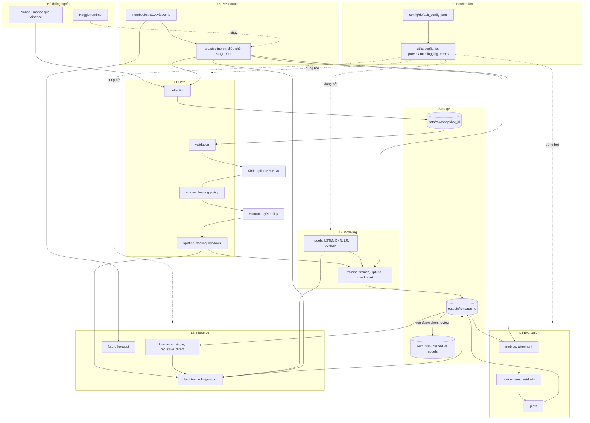
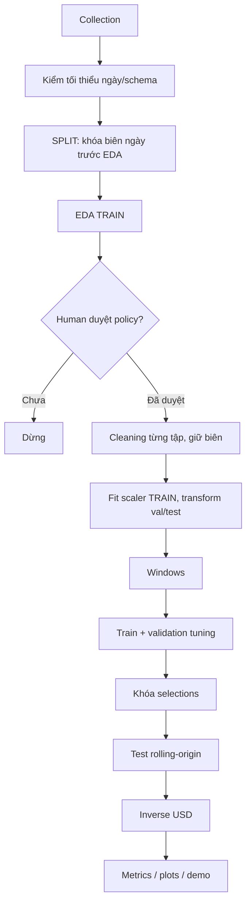

# StockVision — Software Design Specification

Thiết kế kiến trúc và kỹ thuật triển khai Python (.py). Nguồn yêu cầu chuẩn: [DEFINE.md](DEFINE.md). Cập nhật: 2026-11-13.

**Confirmed:** human đã duyệt trong DEFINE hoặc thảo luận. **Proposed:** thiết kế mới chờ duyệt. **TBD:** còn cần quyết định hoặc kiểm chứng. Các chữ ký/schema chưa được duyệt riêng vẫn Proposed. F/E/D dẫn ID trong DEFINE; DD là quyết định thiết kế. Mọi dẫn chiếu §... không ghi tên tài liệu đều chỉ mục của DEFINE; số mục nội bộ DESIGN luôn ghi rõ 'mục'.

## 1. System Architecture

**DD-01 Proposed:** pipeline phân lớp theo stage, dataclass + file artifact; hướng điều phối đã được duyệt, chi tiết lớp/contract chờ review. **DD-02 / Q-07 Confirmed:** src/pipeline.py là điều phối mỏng, Notebook gọi chung module. **Q-06 Confirmed:** SQLite trong run, trial exports; không hứa DB tự bảo đảm resume exact khi thiếu RNG/sampler/runtime state.

### 1.1. Phong cách kiến trúc

**Layered batch pipeline (kiến trúc phân lớp, xử lý theo lô)** với artifact trung gian trên đĩa. Lý do:

| Yêu cầu | Cách kiến trúc đáp ứng |
|---|---|
| Dữ liệu ngày, quy mô nhỏ, chạy theo lô | Không cần service, queue hay database sản phẩm (§6.2 cấm thêm dịch vụ DB) |
| Chống leakage | Mỗi stage nhận đầu vào tường minh; `datasets.splitting` là nơi duy nhất sinh biên thời gian |
| Truy vết, tái lập | Mọi stage ghi artifact + provenance vào thư mục run |
| Notebook chỉ gọi module | Lớp trình diễn nằm trên cùng, không chứa logic |
| Hai môi trường (local, Kaggle) | Đường dẫn qua config, không hardcode |

### 1.2. Các lớp và trách nhiệm

| Lớp | Package | Trách nhiệm | Phụ thuộc được phép |
|---|---|---|---|
| L5 Presentation | `notebooks/`, `src/pipeline.py` | Gọi hàm, hiển thị; không chứa thuật toán | L1–L4 |
| L4 Evaluation | `src/evaluation/` | Metrics, căn chỉnh, so sánh, biểu đồ | L1, dữ liệu CSV từ predict |
| L3 Inference | `src/predict/` | Single/Recursive/Direct, backtest rolling-origin, future forecast | L1, L2, `datasets` |
| L2 Modeling | `src/models/`, `src/training/` | Kiến trúc, baseline, vòng huấn luyện, Optuna, checkpoint | L1, `datasets` |
| L1 Data | `src/datasets/` | Collection, validation, EDA, cleaning, split, scale, window | `utils` |
| L0 Foundation | `src/utils/`, `config/` | Config, logging, IO, hash, provenance, seed, lỗi, helper vẽ | (không) |

**Quy tắc phụ thuộc (một chiều):** `utils ← datasets ← models ← training ← predict`; `evaluation` chỉ đọc bảng prediction và chuỗi Close nên **không import `models`/`training`**. Không có phụ thuộc vòng. `tests/` được import tất cả.

### 1.3. Hệ thống ngoài

| Hệ thống | Vai trò | Giao tiếp | Ghi chú |
|---|---|---|---|
| Yahoo Finance qua `yfinance` | Nguồn OHLCV, Adj Close, Dividends, Splits | Gọi thư viện Python (HTTP do yfinance quản lý) | `auto_adjust=False`; chịu lỗi mạng/rate-limit/rỗng (F01) |
| Kaggle | Huấn luyện, tuning | Chạy cùng source, đường dẫn đổi qua config | GPU/runtime là TBD (D03) |
| Hệ thống file | Lưu snapshot, run, published | Đọc/ghi qua `utils.io` | Ghi atomic (file tạm rồi rename) |
| Optuna | Tuning | Thư viện, storage qua `StudyStore` | Confirmed: SQLite trong run, xuất thêm bảng trial; lưu/chuyển DB khi rời Kaggle |

Không có API HTTP do dự án cung cấp. Các "giao diện" thực tế được nêu ở mục 5.

### 1.4. Sơ đồ kiến trúc



### 1.5. Cơ chế giao tiếp và ranh giới

| Cơ chế | Dùng cho | Ranh giới |
|---|---|---|
| Gọi hàm Python với dataclass có kiểu | Giao tiếp giữa module trong một process | Mỗi package chỉ export qua `__init__.py` |
| File artifact (CSV/JSON/PT/PNG) | Truyền kết quả giữa stage, giữa Kaggle và local | Đọc qua `utils.io`/`RunContext`, không dùng đường dẫn thô |
| `config.yaml` bất biến mỗi run | Truyền tham số | Config được validate một lần ở `utils.config` |

**Ranh giới cứng (boundary rules):**
1. Chỉ `datasets.splitting` tạo biên train/val/test; mọi module khác nhận `SplitManifest`.
2. Chỉ `datasets.scaling` fit scaler, và chỉ trên train.
3. Chỉ `evaluation` tính metric; `training` chỉ tính MSE scaled cho objective.
4. Notebook không import `torch.nn`, `optuna`, `statsmodels` trực tiếp.
5. Test split chỉ được mở sau khi `tuning` ghi cờ `selection_locked=true` trong provenance (DD-11, mục 4.4).

### 1.6. Lựa chọn công nghệ

Stack **Confirmed** theo DEFINE §6.1; phiên bản cụ thể là TBD (D03).

| Công nghệ | Dùng cho | Lý do |
|---|---|---|
| PyTorch | LSTM, CNN | Chỉ định theo project; không dùng TensorFlow |
| yfinance | Collection | Chỉ định; hỗ trợ `auto_adjust=False` |
| pandas, NumPy | Dữ liệu bảng, mảng | Tiêu chuẩn |
| scikit-learn | MinMaxScaler, LinearRegression, một số metric | Chỉ định |
| statsmodels | ARIMA, ADF/ACF/PACF | Chỉ định; `append(refit=False)` |
| Optuna | TPE + MedianPruner | Chỉ định |
| Matplotlib, seaborn | Biểu đồ PNG | Chỉ định |
| PyYAML | Config | Chỉ định |
| pytest | Kiểm thử | Chỉ định |


---

## 2. Modules — Thiết kế module chức năng

Chín module chức năng. Tên module là định danh Design (không phải requirement ID).

| Module | Responsibility | Features | Input | Output | Dependencies | Requirements |
|---|---|---|---|---|---|---|
| **MOD-FOUND** Foundation (`utils`, `config`) | Config, seed, IO atomic, hash, provenance, logging, lỗi, helper vẽ | Nạp/validate config; tạo run bất biến; chụp môi trường | `default_config.yaml`, override | `AppConfig`, `RunContext`, `provenance.json`, `environment_snapshot.json` | — | §4.1C–D, §4.6, §6.3, §7.6, E12 |
| **MOD-ACQ** Acquisition (`datasets.collection`, `trading_calendar`) | Tải và khóa snapshot | Tải yfinance; loại phiên chưa đóng; checksum; cache có nhãn | `DataConfig` | `data/raw/<snapshot_id>/{prices.csv, metadata.json}` | MOD-FOUND | F01, E01, D01 |
| **MOD-QA** Quality & EDA (`validation`, `eda`) | Phát hiện lỗi dữ liệu, khảo sát train | Báo cáo chất lượng, thống kê mô tả, ACF/PACF, ADF, đề xuất policy | Raw snapshot, biên ngày đã khóa | `eda/quality_report.csv`, `eda/eda_report.*`, `eda/findings_hash` | MOD-FOUND (schema), dữ liệu/manifest do pipeline truyền | F02, E02, D02 |
| **MOD-PREP** Preprocessing (`cleaning`, `features`, `splitting`, `scaling`, `windows`) | Biến raw thành tensor đúng quy tắc, chống leakage | Áp policy duyệt; biên ngày giữ nguyên sau cleaning; scaler train-only; sliding window | Raw, policy đã duyệt | Cleaned data, `split_manifest.json`, `scaler.json`, `WindowSet` | MOD-FOUND (schema/IO); nhận policy qua tham số/artifact, không import QA | F02, E02, E03, E05, D02, D06 |
| **MOD-MODEL** Model zoo (`models`) | Định nghĩa kiến trúc và baseline | LSTM, CNN 1D, Linear Regression, ARIMA(5,1,0); factory | Siêu tham số, horizon | Đối tượng model | MOD-PREP (schema) | F03, F08, F09 |
| **MOD-TRAIN** Training & Tuning (`training`) | Huấn luyện, Optuna, early stopping, checkpoint | `fit`, 4 study, `BudgetGuard`, lưu/nạp checkpoint, đo thời gian | `WindowDataset` train/val, search space | `models/*.pt`, `tuning/*.jsonl`, loss history, `selection_manifest.json` | MOD-MODEL, MOD-PREP, MOD-FOUND | F03, E04, E10, D04 |
| **MOD-INFER** Inference (`predict`) | Dự báo single/recursive/direct, backtest, future | Rolling-origin, cohort chung, inverse-scale, bảng dài | Model, scaler, chuỗi, manifest | `predictions/*.csv` | MOD-MODEL, MOD-PREP, MOD-TRAIN (checkpoint) | F04, F07, F09, E05, E08, E09 |
| **MOD-EVAL** Evaluation & Reporting (`evaluation`) | Metrics, so sánh, residual, biểu đồ | MAE/MSE/RMSE/MAPE/R²/DA; error theo step; 9 biểu đồ | Prediction CSV, Close đã làm sạch, loss history | `metrics/*.csv\|json`, `plots/*.png` | MOD-FOUND (không phụ thuộc MOD-MODEL/TRAIN) | F05, F06, F08, E06, E07 |
| **MOD-ORCH** Orchestration & Demo (`pipeline.py`, `notebooks/`) | Điều phối stage và trình diễn | CLI các stage; Notebook EDA và Demo | Config, artifact | Run hoàn chỉnh; notebook hiển thị | Tất cả | F10, E11, D07, D08 |

**Phân định tránh chồng lấn**
- Chỉ **MOD-PREP** tạo biên split và fit scaler; MOD-QA chỉ đọc manifest đã khóa trước EDA.
- Chỉ **MOD-EVAL** tính metric; MOD-TRAIN chỉ tính MSE scaled cho objective (gắn nhãn `scaled`).
- **MOD-INFER** sinh prediction, không đánh giá; **MOD-EVAL** không chạy model.
- Baseline được *định nghĩa* ở MOD-MODEL, được *chạy* qua MOD-INFER, nên không có thuật toán trùng lặp.

**Ma trận phụ thuộc import (không phải thứ tự thực thi)** (hàng phụ thuộc cột)

| | FOUND | ACQ | QA | PREP | MODEL | TRAIN | INFER | EVAL |
|---|:-:|:-:|:-:|:-:|:-:|:-:|:-:|:-:|
| ACQ | ✓ | | | | | | | |
| QA | ✓ | | | | | | | |
| PREP | ✓ | | | | | | | |
| MODEL | ✓ | | | ✓ | | | | |
| TRAIN | ✓ | | | ✓ | ✓ | | | |
| INFER | ✓ | | | ✓ | ✓ | ✓ | | |
| EVAL | ✓ | | | | | | | |

Confirmed: pipeline gọi splitting trước, truyền train/manifest cho EDA; sau human review truyền policy cho cleaning. EDA và cleaning không import/gọi chéo. Ma trận chỉ biểu diễn import, không biểu diễn thứ tự artifact. QA và PREP dùng schema chung.

---

### 2.1. Danh sách file Python và phụ thuộc

| File | Responsibility | Chính (class/hàm) | Phụ thuộc nội bộ | Requirement |
|---|---|---|---|---|
| `src/utils/errors.py` | Hệ phân cấp exception | `StockVisionError` và con | — | §4.1D, E01–E06 |
| `src/utils/config.py` | Nạp, validate, đóng băng config | `load_config`, `AppConfig` và sub-config | errors | §4.1C, §6.2 |
| `src/utils/seed.py` | Seed và deterministic | `set_global_seed` | — | §6.3, §7.6 |
| `src/utils/io.py` | Ghi atomic, hash, JSON/CSV | `atomic_write`, `sha256_file`, `write_json`, `read_json` | errors | §4.6 |
| `src/utils/provenance.py` | Run context, env snapshot, provenance | `RunContext`, `create_run`, `capture_environment` | io, config | §4.6, E12 |
| `src/utils/logging_utils.py` | Logging có cấu trúc | `get_logger` | — | §6.3 |
| `src/utils/plotting.py` | Helper vẽ dùng chung (style, lưu PNG kèm metadata) | `save_figure`, `apply_style` | io | §4.5 |
| `src/datasets/schema.py` | Dataclass dữ liệu dùng chung | `Snapshot`, `QualityReport`, `ReviewPolicy`, `SplitManifest`, `FeatureSpec`, `WindowSet` | — | §4.1, §4.3 |
| `src/datasets/trading_calendar.py` | Interface lịch sàn | `TradingCalendar` (Protocol), `IndexCalendar` | schema | Q-01, D01 |
| `src/datasets/collection.py` | Tải và khóa snapshot | `collect_snapshot`, `load_snapshot` | schema, io, config | F01 |
| `src/datasets/validation.py` | Kiểm tra chất lượng | `validate_prices` | schema | F02, E02 |
| `src/datasets/eda.py` | Khảo sát trên train | `run_eda`, `adf_report`, `acf_pacf_report` | schema | F02 |
| `src/datasets/cleaning.py` | Áp policy đã duyệt | `load_approved_policy`, `apply_policy` | schema, io | F02, E02 |
| `src/datasets/features.py` | Feature nhân quả | `build_features` | schema | §4.1B |
| `src/datasets/splitting.py` | Khóa split trước EDA; giữ biên sau cleaning | `lock_split`, `recount_split` | schema | F02, E03 |
| `src/datasets/scaling.py` | MinMaxScaler train-only | `fit_scaler`, `ScalerState` | schema, io | F02, E03 |
| `src/datasets/windows.py` | Sliding window, `Dataset` | `make_windows`, `WindowDataset` | schema | F02, E03, E05 |
| `src/models/base.py` | Giao diện forecaster | `ForecastModel` (Protocol) | — | DD-07 |
| `src/models/lstm.py` | LSTM | `LSTMForecaster` | — | F03 |
| `src/models/cnn.py` | CNN 1D | `CNN1DForecaster` | — | F08 |
| `src/models/baselines.py` | Linear Regression, ARIMA | `LinearRegressionBaseline`, `ArimaBaseline` | schema | F09 |
| `src/models/factory.py` | Dựng model từ config | `build_model` | lstm, cnn, baselines, config | F03, F08 |
| `src/training/trainer.py` | Vòng train/val | `fit`, `evaluate_loss`, `FitResult` | models, datasets, utils | F03, E04 |
| `src/training/checkpoint.py` | Lưu/nạp checkpoint | `save_checkpoint`, `load_checkpoint` | io | F03, E04 |
| `src/training/tuning.py` | Optuna study | `run_study`, `StudyStore`, `TrialRecord` | trainer, checkpoint | F03, E10 |
| `src/training/runtime.py` | Timing, device | `Timer`, `select_device` | — | §7.4 |
| `src/predict/forecaster.py` | Single/Recursive/Direct | `forecast_single`, `forecast_recursive`, `forecast_direct` | models, datasets | F04, F07, E08 |
| `src/predict/backtest.py` | Rolling-origin trên val/test | `list_origins`, `run_backtest` | forecaster, datasets | F04, F07, F09, E09 |
| `src/predict/future.py` | Dự báo từ origin cuối | `forecast_future` | forecaster, calendar | F04, F07, F10 |
| `src/predict/tables.py` | Dựng bảng CSV dài | `build_prediction_rows`, `PREDICTION_COLUMNS` | schema | §4.4B |
| `src/evaluation/metrics.py` | Công thức §7.2 | `compute_metrics`, `MetricResult` | — | F05, E06 |
| `src/evaluation/alignment.py` | Join prediction với actual, cohort chung | `attach_origin_close`, `common_cohort` | tables | F08, F09, E09 |
| `src/evaluation/comparison.py` | Bảng so sánh, error theo step | `build_comparison`, `error_by_step` | metrics, alignment | F08 |
| `src/evaluation/residuals.py` | Residual | `residual_frame` | alignment | §4.5 |
| `src/evaluation/plots.py` | 9 biểu đồ §4.5 | `plot_*` | utils.plotting | F06, E07 |
| `src/pipeline.py` | Điều phối stage, CLI | `run_collection`, `run_eda`, `run_preprocess`, `run_tuning`, `run_backtest_all`, `run_evaluation`, `main` | tất cả | DD-02 |

**Đồ thị phụ thuộc** (mũi tên = "import"): `pipeline → {predict, evaluation, training, datasets, utils}`; `predict → {models, datasets, utils}`; `training → {models, datasets, utils}`; `models → {datasets.schema}`; `evaluation → {utils}` + dữ liệu CSV; `datasets → utils`.


---

## 3. Folder Structure — Tổ chức dự án

**DD-03 / Q-04 / Q-10 Confirmed:** CSV + metadata/checksum cho snapshot; runs giữ gốc, published giữ evidence, models giữ gói run/trial chọn tường minh, không tự chọn latest.

Cấu trúc đích giữ các thư mục hiện có; `[NEW]` là file dự kiến, chưa được triển khai, `[SẼ SINH]` là artifact runtime. Tên file chi tiết là Proposed nếu chưa được duyệt riêng.

```text
Stock-Forecasting/
├── .agents/                          # (giữ) quy trình AI; KHÔNG chứa code sản phẩm
├── config/
│   └── default_config.yaml           # (giữ) nguồn cấu hình duy nhất; override Kaggle qua PathConfig
├── data/
│   └── raw/<snapshot_id>/            # [SẼ SINH] prices.csv + metadata.json (cache chung, khóa checksum)
├── docs/                             # (giữ) tài liệu tham khảo; DESIGN.md KHÔNG đặt ở đây (xem ghi chú)
├── models/                           # (giữ) bàn giao checkpoint + scaler của run được chọn xuất bản
│   └── README.md
├── notebooks/
│   ├── 01_eda.ipynb                  # [NEW] gọi pipeline.run_eda, hiển thị bảng review; không chứa logic
│   └── 02_demo.ipynb                 # [NEW] F10: load artifact, forecast, hiển thị/xuất
├── outputs/
│   ├── runs/<run_id>/                # [SẼ SINH] bất biến; layout dưới đây
│   │   ├── config.yaml               #   bản config đã resolve
│   │   ├── environment_snapshot.json
│   │   ├── provenance.json
│   │   ├── eda/                      #   quality_report.csv, eda_report, approved_policy.yaml
│   │   ├── data/                     #   cleaned.csv, split_manifest.json, feature_spec.json
│   │   ├── preprocessing/            #   scaler.json
│   │   ├── models/                   #   <study>_<trial>.pt, linear_regression.json, arima_params.json
│   │   ├── tuning/                   #   <study>_trials.jsonl, <study>_summary.json, selection_manifest.json
│   │   ├── predictions/              #   <model>_<method>_<split>.csv
│   │   ├── metrics/                  #   metrics_*.csv|json, runtime.json
│   │   └── plots/                    #   9 loại PNG theo §4.5
│   └── published/                    # (giữ) evidence đã review, chọn tường minh (không mặc định run mới nhất)
├── src/
│   ├── __init__.py
│   ├── pipeline.py                   # [NEW] DD-02: điều phối stage + CLI
│   ├── datasets/
│   │   ├── README.md
│   │   ├── schema.py                 # [NEW] dataclass dùng chung
│   │   ├── trading_calendar.py       # [NEW] interface lịch sàn (Q-01)
│   │   ├── collection.py   validation.py   eda.py   cleaning.py
│   │   ├── features.py     splitting.py    scaling.py   windows.py
│   ├── models/
│   │   ├── README.md
│   │   ├── base.py   lstm.py   cnn.py   baselines.py   factory.py
│   ├── training/
│   │   ├── README.md
│   │   ├── trainer.py   tuning.py   checkpoint.py   runtime.py
│   ├── predict/
│   │   ├── README.md
│   │   ├── forecaster.py   backtest.py   future.py   tables.py
│   ├── evaluation/
│   │   ├── README.md
│   │   ├── metrics.py   alignment.py   comparison.py   residuals.py   plots.py
│   └── utils/
│       ├── README.md
│       ├── errors.py   config.py   seed.py   io.py   provenance.py   logging_utils.py   plotting.py
├── tests/
│   ├── __init__.py
│   ├── conftest.py                   # [NEW] fixture dữ liệu tổng hợp (không cần mạng)
│   ├── test_config.py   test_collection.py   test_validation.py
│   ├── test_splitting_scaling.py     # E03 (leakage, biên split)
│   ├── test_windows.py               # E03, E05 (shape, target trong split)
│   ├── test_models_shapes.py         # E04, E05
│   ├── test_training.py              # E04, E10 (sanity, checkpoint, budget)
│   ├── test_forecaster.py            # E08 (spy recursive, direct shape)
│   ├── test_metrics.py               # E06 (tính tay, undefined)
│   ├── test_cohort_baselines.py      # E09
│   ├── test_plots.py                 # E07
│   ├── test_provenance.py            # E12
│   └── test_notebook_smoke.py        # E11
├── .gitignore  AGENTS.md  DEFINE.md  DESCRIPTION.md  DESIGN.md  walkthrough.md
├── plan-progress.status.md  requirements.txt  README.md
```

| Thư mục / file | Mục đích | Lưu gì | Module | Quan hệ |
|---|---|---|---|---|
| `config/default_config.yaml` | Cấu hình tập trung | Tham số §4.1C, §6.2 | MOD-FOUND | Mỗi run copy thành `runs/<id>/config.yaml` |
| `data/raw/<snapshot_id>/` | Snapshot bất biến | CSV + metadata + checksum | MOD-ACQ | `provenance.json` của run tham chiếu `snapshot_id` |
| `src/datasets/` | Lớp dữ liệu | Collection → window | MOD-ACQ, QA, PREP | Được `models`, `training`, `predict` import |
| `src/models/` | Kiến trúc | Class model, baseline, factory (**không** trọng số) | MOD-MODEL | Dùng bởi `training`, `predict` |
| `src/training/` | Huấn luyện | Loop, Optuna, checkpoint | MOD-TRAIN | Ghi vào `runs/<id>/models,tuning` |
| `src/predict/` | Suy luận | Forecast, backtest, future | MOD-INFER | Ghi `runs/<id>/predictions` |
| `src/evaluation/` | Đánh giá | Metrics, so sánh, plots | MOD-EVAL | Đọc `predictions`, ghi `metrics`, `plots` |
| `src/utils/` | Nền tảng | Không chứa business logic | MOD-FOUND | Mọi package dùng |
| `src/pipeline.py` | Điều phối | Chỉ gọi hàm, không thuật toán | MOD-ORCH | Dùng bởi Notebook, Kaggle |
| `notebooks/` | EDA, demo | Cell gọi module | MOD-ORCH | Không logic |
| `outputs/runs/` | Artifact từng run | Xem layout | Tất cả | Gitignore |
| `outputs/published/` | Evidence xuất bản | CSV/PNG/JSON đã review | MOD-EVAL | Chọn tường minh |
| `models/` | Bàn giao model | `.pt`, `scaler.json`, README | MOD-TRAIN | Notebook demo nạp từ đây hoặc từ run (gói bàn giao đã duyệt) |
| `tests/` | Kiểm thử | Test theo E01–E12 | Tất cả | Dùng fixture tổng hợp |

**Ghi chú**
1. DESIGN.md giữ tại root theo yêu cầu human; không nhân bản.
2. **`.gitignore` phải loại:** `outputs/runs/`, `data/raw/`, `models/*.pt`, `*.db`, `__pycache__/`, `.env`.
3. **Không tạo file rỗng** để giả tiến độ (Define §6.3): file `[NEW]` chỉ được tạo trong milestone triển khai tương ứng.
4. Nội dung README của từng package (đã có) được cập nhật theo D08 bằng plan riêng, không thuộc tài liệu này.

---

## 4. Data Flow — Luồng xử lý dữ liệu

**DD-05:** human-review gate đã duyệt; YAML/hash là hiện thực Proposed. **DD-06:** mọi model cùng cohort đã chốt. **DD-10 Proposed:** dùng best checkpoint train-only, không tự refit train+val; **DD-11:** test chỉ sau khóa lựa chọn.

### 4.1. Sơ đồ



### 4.2. Bảng stage

| Stage | Input | Processing | Output |
|---|---|---|---|
| 1 Collection | Config NVDA/5y/1d | Lấy snapshot, calendar kiểm phiên đã đóng | CSV/metadata/hash |
| 2 Minimal validation | Raw | Chỉ kiểm schema ngày, thứ tự; index mơ hồ dừng trình human; chưa EDA | Index có thể khóa biên |
| 3 Split | Index | Khóa 70/15/15 trước EDA, lưu biên ngày | Fixed SplitManifest |
| 4 Quality / EDA | Train và fixed manifest | Missing/duplicate/outlier, mô tả/ACF/PACF/ADF trên train; chưa sửa | Findings/policy draft |
| 5 Human review / Cleaning | Findings, policy được duyệt | Pipeline truyền policy cho cleaning; xử lý từng tập, không dời biên | Cleaned/change log/counts |
| 6 Scaling | Train | Fit MinMax train-only, transform val/test | Scaler fitted state |
| 7 Windows | Scaled data/fixed manifest | 60 phiên -> 1/5 target trong split | X/Y/origin metadata |
| 8 Train / Tuning | Train/validation | 4 studies, checkpoints; SQLite và trial table | Selections |
| 9 Forecast | Model/history đến origin | Single/Recursive/Direct; ARIMA append refit=False | Predictions |
| 10 Inverse | Scaled predictions | Đưa về USD; ARIMA USD không inverse lần nữa | USD actual/pred |
| 11 Evaluation | Aligned cohort | Metrics/residuals theo DEFINE | Bảng kết quả |
| 12 Visualization / Export | Run artifacts | Hình, report, demo/package chọn tường minh | Published/model bundle |

Confirmed: chia trước EDA; sau cleaning giữ ngày biên, cập nhật counts/positions, không phân chia lại để bù số dòng. Rounding floor(70%N)/floor(15%N) và phần dư test là Proposed cần review. Khi cleaning làm mất phiên, giữ thông tin gap; policy xử lý/bỏ window qua gap phải duyệt ở M3, không nén phiên rồi coi là next-day ngầm.

### 4.3. Đường lỗi và quy tắc xuyên suốt

| Điểm | Lỗi | Hành vi |
|---|---|---|
| Collection | Mạng/rỗng/rate-limit | `DataSourceError`; cache chỉ khi đúng snapshot+config, gắn `from_cache` |
| Validation | Close ≤ 0, trùng khác giá | Trình human, không sửa |
| Review | Thiếu/lệch policy | Dừng cứng |
| Split | Thiếu mẫu | Báo số mẫu từng tập; không đổi window/horizon/split |
| Training | Loss non-finite | Trial FAIL, không điểm giả |
| Forecast | Prediction non-finite, shape sai | Dừng, báo |
| Evaluation | MAPE `y=0`, bước R² undefined | Ghi undefined + lý do, không bỏ ngầm |

**Quy tắc leakage thực thi trong flow:** không shuffle chuỗi trước split; scaler/imputer/feature selection chỉ fit ở train; test không dùng cho chọn siêu tham số/checkpoint/policy; Recursive không đọc actual trong horizon; rolling-origin chỉ thêm actual **sau** khi origin chuyển tiếp.

**DD-04 Confirmed:** thiết kế chia hai lượt cũ được thay bằng khóa biên ngày một lần trước EDA. DEFINE §4.2–4.3 cần đồng bộ bằng plan tài liệu riêng trước implementation; không gọi việc dời split là hiệu chỉnh nhỏ.

---

### 4.4. DD-11 — Khóa lựa chọn trước khi mở test

`RunContext` giữ cờ `selection_locked`. Chỉ pipeline đặt cờ sau khi cả bốn study chọn COMPLETE trial, baseline artifacts/scaler/split/snapshot/config references đã kiểm, và selection_manifest.json đã ghi thành công. `run_backtest` trên split `test` kiểm cờ này; thiếu → `LeakageError`. Baseline: Linear Regression và ARIMA được fit từ train, cũng bị chặn test trước khóa. Đây là cơ chế kỹ thuật cho yêu cầu "không dùng test để tuning" (§7.3, E10).


---

## 5. Interface / APIs — Hợp đồng giao tiếp

Dự án **không có HTTP API** (ngoài phạm vi, Define §5). Giao tiếp thực tế gồm: (a) gọi hàm giữa module, (b) file artifact, (c) gọi thư viện ngoài `yfinance`.

**DD-08 Proposed:** scaler/LR JSON, DL state_dict + construction config; ARIMA cần cả history/state phù hợp và round-trip forecast test, không hứa params JSON là đủ. **DD-09:** prediction CSV dài theo DEFINE. **Q-11 Confirmed:** join Close tại origin từ dữ liệu đã khóa để tính DA; missing/nonunique join phải lỗi.

### 5.1. Giao diện ngoài: yfinance

| Field | Mô tả |
|---|---|
| Endpoint | `yfinance.Ticker(ticker).history(...)` (hàm thư viện; HTTP do yfinance quản lý) |
| Method | Gọi hàm (đọc) |
| Request | `ticker="NVDA"`, `period="5y"` **hoặc** `start/end` (không dùng đồng thời mơ hồ), `interval="1d"`, `auto_adjust=False`, `actions=True` |
| Response | DataFrame, index datetime có múi giờ; cột `Open, High, Low, Close, Adj Close, Volume, Dividends, Stock Splits` |
| Schema bắt buộc | Tối thiểu `Open, High, Low, Close, Volume`; `Adj Close` và actions lưu nếu có |
| Error Handling | Rỗng → `DataSourceError`; exception mạng/rate-limit → `DataSourceError` (giữ nguyên nguyên nhân); cột thiếu → `SchemaMismatchError`; cache chỉ khi `allow_cache` và khớp config |

Lưu ý: chi tiết tham số thực tế (ví dụ biên `end` exclusive) phải xác minh với phiên bản yfinance đã cài (D03).

### 5.2. Giao diện nội bộ (chữ ký chính)

Các hợp đồng hàm theo file được ghi một lần tại mục 5.7; mục này giữ các Protocol và boundary adapter chung.

**Giao diện model thống nhất (DD-07)**

```python
class ForecastModel(Protocol):          # models/base.py
    horizon: int
    def forward(self, x: "torch.Tensor") -> "torch.Tensor": ...   # (B,60,1) -> (B,H)
```
Baseline dùng adapter `BaselineAdapter.predict_origins(history: Arr, origins: Arr, steps: int) -> Arr (n_origins, steps)` ở `predict`, để backtest xử lý đồng nhất.

**Giao diện lịch sàn (Q-01)**
```python
class TradingCalendar(Protocol):
    def next_sessions(self, last: pd.Timestamp, n: int) -> pd.DatetimeIndex: ...
class IndexCalendar:   # chỉ dùng cho backtest: tra cứu trong index thực của snapshot
```
Confirmed dùng thư viện lịch NASDAQ hỗ trợ holidays/early-close; tên/version/coverage TBD, kiểm ở M0. Thiếu calendar tương lai thì chưa hoàn thành future forecast/M9; không thay bằng ngày lịch hoặc chỉ bỏ cuối tuần.

### 5.3. Data contracts (file)

| Contract | Định dạng | Trường bắt buộc | Validation |
|---|---|---|---|
| `metadata.json` (snapshot) | JSON | `snapshot_id, ticker, interval, auto_adjust, request_params, actual_start, actual_end, retrieved_at, timezone, checksum, from_cache` | checksum khớp lúc load |
| `approved_policy.yaml` | YAML | `findings_hash, approved_by, approved_at, cleaning, features` | hash khớp findings hiện tại |
| `split_manifest.json` | JSON | `snapshot_hash, locked_date_bounds, train/val/test: {original_count, cleaned_count, current_positions}`, `rounding_rule` | ngày biên khóa không đổi; counts sau cleaning được báo riêng, không tái chia theo N mới |
| `scaler.json` | JSON | `class/version, fitted attributes đầy đủ, feature order/range, fit_start, fit_end, n_train` | `fit_end ≤ train_end` |
| Prediction CSV | CSV dài | `run_id, model_name, forecast_method, forecast_origin, target_date, step, horizon, predicted_close_usd, actual_close_usd, config_reference, snapshot_reference` | `predicted` hữu hạn; `1≤step≤horizon`; actual null cho tương lai |
| `metrics_*.csv/json` | CSV/JSON | `model, method, step|aggregate, MAE, MSE, RMSE, MAPE, R2, DA, n_origins, undefined_reason` | cùng cohort |
| `<study>_trials.jsonl` | JSONL | `trial_id, state(COMPLETE/PRUNED/FAIL), params, objective_val_mse_scaled, best_epoch, epochs_run, duration_s, checkpoint, sampler, pruner` | không quá 10 trial ID duy nhất/study kể cả resume |
| `selection_manifest.json` | JSON | `study, trial_id, objective, checkpoint_sha256, baseline_refs, scaler/split/snapshot/config hashes, locked_at` | đủ 4 study và baseline hợp lệ |
| `runtime.json` | JSON | `device, gpu_model, batch, precision, epochs, fit/val/ckpt/total_s` | ghi hardware |
| `provenance.json` | JSON | `run_id, seed, snapshot_id, snapshot_checksum, split_manifest_hash, policy_hash, scaler_hash, checkpoints, package_versions, code_revision?, selection_locked` | đủ cho E12 |

### 5.4. Giao diện Notebook (F10, D07)

Notebook chỉ gọi: `load_run(run_id) -> RunHandle`, `forecast_future(...)`, `plot_*`, `build_comparison`. Cell đầu kiểm artifact (`ArtifactMissingError` kèm hướng dẫn); **không** có cell tự chạy tuning. Thứ tự cell, ô cấu hình và mức Python yêu cầu: **TBD (D07)**.

### 5.5. Chính sách validation giao diện

Mọi hàm public: kiểm kiểu/shape ở biên vào, ném `StockVisionError` con (mục 5.6); không `print` lỗi rồi bỏ qua; không `except Exception: pass`.

---

### 5.6. Exception hierarchy (`utils/errors.py`)

| Exception | Khi nào | Xử lý của caller |
|---|---|---|
| `StockVisionError` | Gốc | — |
| `ConfigError` | Ticker/date/config không hợp lệ (split không tổng 1, lookback ≤ 0, vừa `period` vừa ngày...) | Dừng trước training, nêu trường và lý do |
| `DataSourceError` | Mạng, rate-limit, response rỗng | Báo lỗi; fallback cache chỉ nếu đúng snapshot/config và gắn nhãn `from_cache=True` |
| `SchemaMismatchError` | Thiếu cột cần thiết | Dừng, liệt kê cột thiếu; **không** tạo cột giả |
| `DataQualityError` | Dữ liệu vi phạm (Close ≤ 0, duplicate khác giá...) | Dừng, trình human; không sửa ngầm |
| `ReviewRequiredError` | Cleaning/feature chạy khi chưa có policy được duyệt hoặc `findings_hash` lệch | Dừng, yêu cầu duyệt |
| `InsufficientSamplesError` | Không đủ quan sát tạo window/split | Báo số mẫu từng tập; **không** giảm window/horizon/đổi split |
| `LeakageError` | Vi phạm bất biến (target vượt biên split, scaler fit ngoài train, test dùng trước khóa selection) | Dừng cứng |
| `NonFiniteLossError` | Loss NaN/Inf | Trial ghi `FAIL`, không thay bằng điểm giả |
| `ArtifactMissingError` | Thiếu checkpoint/scaler/snapshot (Notebook demo) | Thông báo cách khắc phục, không tự tuning |
| `ShapeError` | Input sai shape | Báo shape kỳ vọng vs thực tế (E05) |

`UndefinedMetric` **không** là exception: metric trả undefined kèm reason (JSON null, không xuất NaN JSON không chuẩn) (xem 3.4).


### 5.7. Hợp đồng chi tiết theo file

Chữ ký/tên schema dưới đây là Proposed contract, không phải code đã tồn tại. Đoạn chữ ký trong mục 5.2 là ký hiệu thiết kế, không phải Python module có thể chạy; implementation phải có imports/type aliases đầy đủ.

#### `src/utils/config.py`

| Field | Mô tả |
|---|---|
| Function | `load_config(path: Path, overrides: dict[str, Any] | None = None) -> AppConfig` |
| Responsibility | Nạp `config/default_config.yaml`, áp override (ví dụ đường dẫn Kaggle), validate, trả cấu hình bất biến |
| Input | `path`, `overrides` |
| Output | `AppConfig` (frozen dataclass gồm `DataConfig, SplitConfig, WindowConfig, ModelConfig, TrainConfig, TuningConfig, BaselineConfig, PathConfig`) |
| Logic | 1) `yaml.safe_load` 2) merge override 3) kiểm: `lookback>0`, `horizon∈{1,5}`, `split` dương và tổng 1 (sai số 1e-9), `start<end`, không dùng đồng thời `period` và `start/end` mơ hồ, `interval=="1d"`, `auto_adjust is False`, `target_col=="Close"` 4) `freeze` |
| Errors | `ConfigError` |

Giá trị mặc định Confirmed: `ticker=NVDA, period=5y, interval=1d, auto_adjust=false, lookback=60, horizons=[1,5], split=[0.70,0.15,0.15], batch_size=32, seed=42`. Tuning: `n_trials=10, max_epochs=50, patience=10, T_max=50, eta_min=0, clip_norm=1.0, tpe_startup=3, pruner_warmup=10`. Search space: `lr∈[1e-4,1e-2] log; hidden/channels∈{32,64,128}; weight_decay∈[1e-6,1e-3] log`.

#### `src/utils/provenance.py`

| Field | Mô tả |
|---|---|
| Function | `create_run(cfg: AppConfig, snapshot: Snapshot, root: Path) -> RunContext` |
| Responsibility | Tạo `outputs/runs/<run_id>/` mới, copy `config.yaml`, ghi `environment_snapshot.json`, `provenance.json` khởi tạo |
| Input | Config, snapshot, root |
| Output | `RunContext(run_id, run_dir, subdir(name)->Path, record(key, value))` |
| Logic | `run_id = <UTC yyyymmddTHHMMSS>_<8 ký tự hash config+snapshot>`; `mkdir(exist_ok=False)`; tạo thư mục con `eda, data, preprocessing, models, tuning, predictions, metrics, plots`; chụp python/OS/CPU/package version/device/git revision (nếu có Git); ghi seed |
| Errors | `FileExistsError` bọc thành `StockVisionError` nếu run_id trùng |

Các hàm hỗ trợ: `capture_environment() -> dict` (không gọi GPU khi không khả dụng; ghi rõ thiết bị dùng thực tế, không suy ra Kaggle GPU đã kiểm từ local), `RunContext.record()` (ghi `selection_locked`, `split_manifest_hash`, đường dẫn artifact).

#### `src/datasets/collection.py`

| Field | Mô tả |
|---|---|
| Function | `collect_snapshot(cfg: DataConfig, root: Path, *, allow_cache: bool = False) -> Snapshot` |
| Responsibility | Tải OHLCV + Adj Close + Dividends + Stock Splits, loại phiên chưa đóng, khóa snapshot (F01) |
| Input | `DataConfig`, thư mục `data/raw/`, cờ cache |
| Output | `Snapshot(snapshot_id, path, actual_start, actual_end, retrieved_at, request_params, checksum, from_cache)` |
| Logic | 1) validate cấu hình 2) `yfinance.Ticker(t).history(auto_adjust=False, ...)` 3) kiểm không rỗng, đủ cột bắt buộc 4) loại nến phiên đang chạy theo quy tắc D01 (Confirmed dùng NASDAQ calendar; tên/version TBD; thiếu lịch thì dừng stage cần lịch, không coi metadata thay thế kiểm phiên) 5) ghi `prices.csv` (Proposed float `%.17g`, reader round-trip phải kiểm), `metadata.json` 6) `checksum=sha256(prices.csv)`; `snapshot_id` từ ticker + range + checksum 7) nếu thư mục đã có, **không ghi đè**; refresh tạo `snapshot_id` mới |
| Errors | `ConfigError`, `DataSourceError`, `SchemaMismatchError` |

Ngoài ra: `load_snapshot(snapshot_id: str, root: Path) -> tuple[DF, Snapshot]` kiểm lại checksum, lệch → `DataQualityError`.

#### `src/datasets/validation.py`

| Field | Mô tả |
|---|---|
| Function | `validate_prices(df: DF, cfg: DataConfig) -> QualityReport` |
| Responsibility | Liệt kê lỗi, **không sửa** dữ liệu (F02/E02) |
| Input | DataFrame raw có `DatetimeIndex` |
| Output | `QualityReport(issues: DF[check, date, column, value, severity], summary: dict)` |
| Logic | Kiểm: index tăng dần; trùng ngày (phân biệt "giống hệt" vs "cùng ngày khác giá"); numeric hữu hạn; missing theo cột; `Volume ≥ 0`; logic OHLC (`Low ≤ min(Open,Close) ≤ max(Open,Close) ≤ High`); `Close > 0` (điều kiện cho MAPE); cờ outlier IQR/Z-score (chỉ là cờ khảo sát, severity `info`). Ngày nghỉ sàn không bị tính là missing |
| Errors | Không raise cho lỗi dữ liệu (ghi vào report); `SchemaMismatchError` nếu thiếu cột |

#### `src/datasets/splitting.py`

| Field | Mô tả |
|---|---|
| Function | `lock_split(index: pd.DatetimeIndex, ratios: tuple[float, float, float]) -> SplitManifest`; `recount_split(index: pd.DatetimeIndex, fixed_manifest: SplitManifest) -> SplitManifest` |
| Responsibility | Sinh biên thời gian; là **nguồn duy nhất** của biên split |
| Logic | `n_train=floor(0.70N)`, `n_val=floor(0.15N)`, `n_test=N−n_train−n_val` (Proposed, DEFINE §4.3). `SplitManifest` lưu vị trí và ngày biên thực tế, `n` mỗi tập. Khóa ngày biên trước EDA; sau cleaning chỉ tái đếm và cập nhật vị trí, không chia lại, không chuyển ngày val/test sang train |
| Errors | `InsufficientSamplesError` nếu một tập không đủ tạo ≥1 window (kèm số mẫu từng tập) |

Bất biến kiểm tra bằng `assert_no_leak(manifest, windows)`: với mọi window thuộc split S, toàn bộ target nằm trong S.

#### `src/datasets/scaling.py`

| Field | Mô tả |
|---|---|
| Function | `fit_scaler(train_close: Arr, train_index: pd.DatetimeIndex, manifest: SplitManifest) -> ScalerState`; `ScalerState.transform(x)`, `inverse_transform(x)`, `to_json()/from_json()` |
| Responsibility | MinMaxScaler fit **chỉ** trên Close của train; không clip |
| Logic | Dùng `sklearn.preprocessing.MinMaxScaler(feature_range=(0,1))`; lưu đầy đủ fitted attributes cần cho transform/inverse, `n_train`, `fit_range` (ngày đầu–cuối train). `inverse_transform` nhận shape `(B,H)` hoặc `(B,)` và giữ nguyên shape |
| Errors | `LeakageError` nếu `train_index` chứa ngày vượt biên train của manifest; `DataQualityError` nếu `data_max==data_min` |

#### `src/datasets/windows.py`

| Field | Mô tả |
|---|---|
| Function | `make_windows(series: Arr, index: pd.DatetimeIndex, manifest: SplitManifest, split: Literal["train","val","test"], lookback: int, horizon: int) -> WindowSet` |
| Responsibility | Tạo X, Y và metadata origin/date cho một split |
| Output | `WindowSet(X: float32 (B,60,1), Y: float32 (B,H), origin_pos: int64 (B,), origin_date: DatetimeIndex, target_dates: (B,H))` |
| Logic | Với split `[a,b)`: origin `t` hợp lệ khi `t−(lookback−1) ≥ 0` (context có thể nằm trước `a`), `t+1 ≥ a`, `t+horizon ≤ b−1`. `X=series[t−59..t]`, `Y=series[t+1..t+H]`. Tập train: `t ≥ 59`. Val/test: `t` bắt đầu từ `a−1` |
| Errors | `InsufficientSamplesError`, `ShapeError` |

Lớp `WindowDataset(torch.utils.data.Dataset)` bọc `WindowSet`, `__getitem__` trả `(x, y)` tensor float32. `DataLoader` train dùng `shuffle=True` **chỉ trên tập window đã tạo** (shuffle các mẫu train không phải shuffle chuỗi trước split; hợp lệ với Define). Val/test: `shuffle=False`.

#### `src/datasets/cleaning.py`

| Field | Mô tả |
|---|---|
| Function | `load_approved_policy(path: Path, findings_hash: str) -> ReviewPolicy`; `apply_policy(df: DF, policy: ReviewPolicy, manifest: SplitManifest) -> tuple[DF, DF]` |
| Responsibility | Áp dụng cleaning chỉ theo policy đã duyệt; trả `(cleaned, change_log)` |
| Logic | Thống kê học (nếu có, ví dụ ngưỡng IQR) chỉ tính từ vùng train. Không backfill/nội suy bằng tương lai. Policy "không làm gì" cũng phải được duyệt tường minh |
| Errors | `ReviewRequiredError`, `DataQualityError` |

#### `src/models/lstm.py`, `cnn.py`

| Field | LSTM | CNN 1D |
|---|---|---|
| Class | `LSTMForecaster(hidden_dim:int=64, num_layers:int=2, dropout:float=0.2, horizon:int=1)` | `CNN1DForecaster(channels:int=64, dropout:float=0.2, horizon:int=1)` |
| Input | `(B,60,1)` float32 | `(B,60,1)` float32 (transpose nội bộ thành `(B,1,60)`) |
| Output | `(B,H)` | `(B,H)` |
| Cấu trúc | `nn.LSTM(1, hidden_dim, 2, dropout=0.2, batch_first=True)` → lấy bước cuối → `nn.Linear(hidden_dim, H)` | `Conv1d(1,C,3,pad=1)`→BN→ReLU→MaxPool(2)→`Conv1d(C,C//2,3,pad=1)`→BN→ReLU→`AdaptiveAvgPool1d(1)`→Flatten→Dropout(0.2)→`Linear(C//2,H)` |
| Errors | `ShapeError` nếu input không 3 chiều hoặc `F≠1` | như bên trái |

**Confirmed — Xuân Thường duyệt 2026-11-13:** thứ tự CNN/padding=1/MaxPool(2)/Dropout(.2), mapping C -> C//2 đã bổ sung vào walkthrough §2.3. C={32,64,128} tạo [32,16]/[64,32]/[128,64]. Đây là thiết kế đã duyệt, chưa phải kết quả chạy.

#### `src/models/baselines.py`

| Field | Mô tả |
|---|---|
| Class | `LinearRegressionBaseline(horizon: int)`: `fit(X: Arr, Y: Arr)`, `predict(X: Arr) -> Arr (B,H)`, `to_json()` |
| Logic | `sklearn.linear_model.LinearRegression()` mặc định (có intercept); `X` flatten `(B,60)`; đầu ra 1 hoặc 5 (một model đa đầu ra cho H=5, huấn luyện riêng với H=1) (Proposed: adapter scaled Q-08). Không tuning |
| Class | `ArimaBaseline(order=(5,1,0), trend: str = "n", fit_history: str = "train")` |
| Logic | Confirmed ARIMA A: fit toàn bộ train bằng `ARIMA(order=(5,1,0), trend="n")`, không tune trend/order. `forecast_from(history_close_up_to_origin, steps=5)`: tiến trạng thái bằng `results.append(new_obs, refit=False)` chỉ với quan sát đã xảy ra, rồi `forecast(steps)`. Tham số cố định sau fit; công bố ARIMA fit toàn train khác input window 60 của DL |
| Errors | Không hội tụ: ghi fit FAIL và nguyên nhân, không báo metric như thành công, không tự đổi order/trend; `InsufficientSamplesError` |

Hai baseline không dùng `ForecastModel` torch; chúng cài chung giao diện `predict_origins(...)` ở `predict.forecaster` thông qua adapter (mục 5).

#### `src/training/trainer.py`

| Field | Mô tả |
|---|---|
| Function | `fit(model: nn.Module, train: WindowDataset, val: WindowDataset, hp: HyperParams, cfg: TrainConfig, *, trial: optuna.Trial | None, ckpt_path: Path, device: torch.device) -> FitResult` |
| Responsibility | Huấn luyện một cấu hình, trả lịch sử và checkpoint tốt nhất theo validation MSE |
| Input | Model, dataset, siêu tham số (`lr, hidden/channels, weight_decay`) |
| Output | `FitResult(best_val_mse, best_epoch, epochs_run, train_loss: list[float], val_loss: list[float], duration_s, status)` |
| Logic | AdamW(lr, wd) → `CosineAnnealingLR(T_max=50, eta_min=0)` step mỗi epoch → mỗi epoch: train (MSELoss, `clip_grad_norm_(1.0)`), validate (MSE scaled, trung bình trên N×H phần tử), `trial.report(val_mse, epoch)` với epoch 1..50, kiểm `trial.should_prune()`; lưu checkpoint khi val tốt hơn; early stopping patience 10. Loss non-finite → dừng và raise. `torch.manual_seed` đặt bởi entry point; trial-level seed/RNG resume policy còn cần plan cụ thể |
| Errors | `NonFiniteLossError`; `optuna.TrialPruned` (được `tuning` bắt) |

Phụ trợ: `evaluate_loss(model, loader, device) -> float` (không cập nhật trọng số — validation không update).

#### `src/training/tuning.py`

| Field | Mô tả |
|---|---|
| Function | `run_study(name: Literal["lstm_single","cnn_single","lstm_direct5","cnn_direct5"], build, windows, cfg: TuningConfig, ctx: RunContext, store: StudyStore) -> StudyResult` |
| Responsibility | Chạy một study tuần tự 10 trial, ghi record từng trial |
| Logic | `TPESampler(n_startup_trials=3, seed=42)`; `MedianPruner(n_startup_trials=5, n_warmup_steps=10, interval_steps=1, n_min_trials=1)` (Confirmed startup/warmup; Proposed interval_steps/n_min_trials); `direction="minimize"`; chạy tối đa số trial còn lại trong ngân sách 10/study kể cả resume không `n_jobs`; objective gọi `fit` và trả `best_val_mse`; trial pruned/failed vẫn có record và **không** sinh trial bù; ghi `COMPLETE/PRUNED/FAIL`, objective, duration, best epoch, epochs thực, cấu hình sampler/pruner, đường dẫn checkpoint (mỗi trial một checkpoint riêng). Study xong → chọn trial COMPLETE có val MSE nhỏ nhất → khóa selection manifest khi cả bốn study chọn được COMPLETE trial, baseline artifacts và scaler/split/snapshot/config hashes hợp lệ |
| Errors | `StockVisionError` nếu không có trial COMPLETE (không tự bù) |

Ngân sách: tối đa 40 trial, 2000 trial-epoch (kiểm bởi `BudgetGuard`; vượt thì dừng và ghi lỗi). Hai study direct-5 dùng `horizon=5` trên window H=5; Recursive **không** có study riêng, dùng model `*_single` đã chọn.

#### `src/predict/forecaster.py`

| Field | Mô tả |
|---|---|
| Function | `forecast_single(model, x_scaled: Arr (B,60,1), device) -> Arr (B,1)` |
| Function | `forecast_recursive(model_single, x_scaled: Arr (B,60,1), steps: int = 5, device) -> Arr (B,5)` |
| Function | `forecast_direct(model_direct5, x_scaled: Arr (B,60,1), device) -> Arr (B,5)` |
| Logic Recursive | Với mỗi origin: dự báo `p1` từ window; cập nhật window = bỏ phần tử đầu, nối `p1`; lặp 5 lần. Hàm **chỉ nhận lịch sử đến origin**, không có tham số actual tương lai (kiểm bằng spy, E08) |
| Logic Direct | Một lần forward `(B,60,1)→(B,5)`; không phải 5 model độc lập |
| Errors | `ShapeError` (kỳ vọng `(B,60,1)`), `StockVisionError` khi prediction không hữu hạn (không gọi nhầm là lỗi loss) |

#### `src/predict/backtest.py`

| Field | Mô tả |
|---|---|
| Function | `list_origins(manifest: SplitManifest, split: str, horizon: int, lookback: int) -> np.ndarray` |
| Logic | Sau cleaning tính lại positions theo index, giữ ngày biên khóa. Origin `t` hợp lệ khi `t−59 ≥ 0`, `t+1 ≥ a`, `t+H ≤ b−1`. Với test: `t ∈ [test_start−1, N−1−H]`, tức `n_test−H+1` origin (H=5: `n_test−4`) |
| Function | `run_backtest(method: Method, model, series_scaled, series_usd, scaler, manifest, origins, ctx) -> DF` |
| Responsibility | Với mỗi origin trong **cohort chung** dự báo, inverse-scale, ghép actual đúng `target_date` rồi trả bảng dài (schema §4.4B) |
| Logic | `Method ∈ {single_step, recursive, direct_multi_output}`; baseline qua adapter. Origin kế tiếp mới được thêm actual vừa xuất hiện (rolling-origin). `target_date` lấy từ index thực của chuỗi (không dùng ngày lịch). Test chỉ chạy khi `selection_locked=True` |
| Errors | `LeakageError` nếu test chạy trước khóa; `InsufficientSamplesError` |

#### `src/predict/future.py`

| Field | Mô tả |
|---|---|
| Function | `forecast_future(run: RunHandle, method: Method, calendar: TradingCalendar) -> DF` |
| Logic | Origin = phiên cuối của snapshot; sinh H ngày giao dịch tiếp theo từ `calendar`; `actual_close_usd=NaN`. Nếu `calendar` chưa cài (Q-01) → `ArtifactMissingError` giải thích; không dùng ngày lịch |
| Errors | `ArtifactMissingError`, `ShapeError` |

#### `src/predict/tables.py`

`PREDICTION_COLUMNS = ["run_id","model_name","forecast_method","forecast_origin","target_date","step","horizon","predicted_close_usd","actual_close_usd","config_reference","snapshot_reference"]`. `build_prediction_rows(...) -> DF` kiểm `predicted` hữu hạn, `1≤step≤horizon`, không điền predicted vào actual.

#### `src/evaluation/metrics.py`

| Field | Mô tả |
|---|---|
| Function | `compute_metrics(df: DF, *, origin_close: Series, by_step: bool = True) -> MetricResult` |
| Input | Bảng dài đã join actual, và Close tại origin (cho DA) |
| Output | `MetricResult(per_step: DF, aggregate: dict, n_origins: int, undefined: dict[str,str])` |
| Logic | Với `e=y−p`: MAE; MSE; RMSE; MAPE=`100·mean(|e/y|)`; `R²_h=1−Σe²/Σ(y−ȳ_h)²`; DA=`100·mean(sign(y−c)==sign(p−c))` (`sign(0)=0`). Tổng hợp: MAE/MSE/RMSE/MAPE gộp N×H cặp (RMSE gộp = căn MSE gộp); **R² tổng = trung bình đều R² từng bước**; bước undefined → R² tổng undefined, ghi lý do. MAPE: bất kỳ `y=0` → undefined (không bỏ mẫu, không thêm epsilon); `y<0` → `DataQualityError` để review. DA step 1 là chính |
| Errors | `DataQualityError`, `ShapeError` |

#### `src/evaluation/alignment.py`

`common_cohort(frames: dict[str, DF]) -> list[tuple[Timestamp,int]]` kiểm mọi (model, method) khớp cohort origin/step kỳ vọng; thiếu prediction thì báo lỗi, không lấy giao nhỏ hơn để che thiếu mẫu; `attach_origin_close(df, close_series) -> DF`. Khi so step 1 giữa các phương pháp dùng cohort chung H=5 (Define §7.4).

#### `src/evaluation/plots.py`

Một hàm cho mỗi biểu đồ §4.5: `plot_historical`, `plot_loss`, `plot_actual_vs_predicted`, `plot_future_forecast`, `plot_multistep`, `plot_model_comparison`, `plot_error_by_step`, `plot_residual_distribution`, `plot_residual_time`. Mỗi hàm nhận DataFrame đã tính, trả `Path` PNG trong `run/plots/` và ghi tiêu đề `ticker/model/method/horizon`. Không tính metric trong hàm vẽ.

#### `src/pipeline.py`

| Hàm | Làm gì | Gọi |
|---|---|---|
| `run_collection(cfg)` | F01 | `collect_snapshot` |
| `run_split(cfg, snapshot)` | Kiểm tối thiểu và khóa biên trước EDA | `validate_index`, `lock_split` |
| `run_eda(cfg, snapshot, manifest)` | Nhận fixed manifest, chỉ EDA train, ghi `eda/`, dừng chờ duyệt | `validate_prices`, `datasets.eda.run_eda`; không chia lại |
| `run_preprocess(cfg, snapshot, manifest, ctx)` | Policy đã duyệt → clean → recount giữ biên → scale → windows | `cleaning`, `splitting`, `scaling`, `windows` |
| `run_tuning(cfg, data, ctx)` | 4 study | `tuning.run_study` |
| `run_backtest_all(cfg, ctx)` | Backtest val/test cho mọi model/method | `predict.backtest` |
| `run_evaluation(cfg, ctx)` | Metrics, so sánh, biểu đồ | `evaluation.*` |
| `main(argv)` | CLI `python -m src.pipeline <stage> --config ...`; đặt seed một lần | `set_global_seed`, `load_config` |


### 5.8. Quy ước dữ liệu dùng chung

| Đối tượng | Kiểu / shape | Ghi chú |
|---|---|---|
| X (DL) | `float32 (B,60,1)` | CNN chuyển nội bộ `(B,1,60)` |
| Y | `float32 (B,1)` hoặc `(B,5)` | Tránh broadcasting ngoài ý muốn: loss kiểm `pred.shape == target.shape` |
| LR input | `float (B,60)` | flatten |
| ARIMA input | chuỗi Close có thứ tự (USD) | không tensor |
| Prediction USD | `float64 (B,H)` | sau inverse-scale |

### 5.9. Seed và tái lập

`set_global_seed(42)` được gọi **một lần** ở `pipeline.main` và ở đầu Notebook; đặt seed `random`, `numpy`, `torch` (+CUDA), `PYTHONHASHSEED` phải đặt trước khi khởi động Python để tác động hash của process; bật `torch.use_deterministic_algorithms(True, warn_only=True)`; ghi chế độ vào `provenance.json`. Không cam kết bitwise giống nhau giữa thiết bị (Define §7.6).


---

## 6. Milestones — Lộ trình triển khai

Thứ tự theo phụ thuộc. Mỗi milestone chỉ kết thúc khi **mọi** acceptance criteria đạt, kèm bằng chứng ghi vào `plan-progress.status.md`. Tiến trình: plan được duyệt → patch → self-review → smoke test → run → đối chiếu Define (§6.3).

| ID | Name | Objectives | Tasks | Dependencies | Deliverables | Acceptance Criteria |
|---|---|---|---|---|---|---|
| **M0** | Đồng bộ môi trường và tài liệu | Giải D03, D08 trước code | Kiểm tương thích Python/OS/CPU, resolver, import, smoke; quyết định pin; thêm Optuna vào requirements bằng patch có duyệt; đồng bộ README/walkthrough/config (plan riêng); kiểm chứng lịch NASDAQ Q-01; Q-07 pipeline đã duyệt; DESIGN giữ ở root | DESIGN được duyệt | Báo cáo môi trường; requirements đã pin (hoặc ghi lý do chưa); quyết định Q-01/Q-07 | Import thành công mọi thư viện ở §6.1 trên local; có `environment_snapshot` mẫu; không `python==...` placeholder |
| **M1** | Foundation | Config, lỗi, seed, IO, provenance | Cài `utils/*`; mở rộng `default_config.yaml` theo `AppConfig` | M0 | `utils/*`, config, `test_config.py`, `test_provenance.py` | Config sai bị từ chối đúng lý do (E-ref §4.1D); run tạo thư mục bất biến, run thứ hai cùng id bị từ chối; **E12 phần provenance** đạt |
| **M2** | Collection, Minimal Validation & Fixed Split | F01, E01, E02 (validation) | `collection`, minimal validation, `lock_split` trước EDA, calendar NASDAQ adapter | M1 | Snapshot NVDA thật; `QualityReport` | **E01:** snapshot + metadata + checksum; mạng/rỗng/schema lỗi cho thông báo rõ; reload khớp checksum; **E02:** fixture lỗi → issue đúng dòng/ngày, không sửa dữ liệu |
| **M3** | EDA train, Review, Preprocessing | F02, E02, E03, E05 (phần window) | `eda`, `cleaning`, `features`, `splitting`, `scaling`, `windows`; notebook `01_eda` | M2 | EDA report; policy duyệt; manifest; scaler; windows | **E03:** fixture val/test cực trị → scaler chỉ phụ thuộc train; không target vượt biên; shape `(B,60,1)` và `(B,H)`; thiếu mẫu → `InsufficientSamplesError` đúng số mẫu; cleaning không chạy khi chưa có policy duyệt |
| **M4** | Models & Training core | F03 (lõi), E04 | `models/{base,lstm,cnn,factory}`, `training/{trainer,checkpoint,runtime}`; sanity overfit 1 batch | M3 | Model + trainer + checkpoint | **E04:** loss hữu hạn; reload checkpoint cho prediction khớp trong tolerance (giá trị tolerance **TBD**, ghi trong plan); input sai shape → `ShapeError`; ngưỡng sanity overfit **TBD** (Q-13) |
| **M5** | Single-step pipeline & Baselines | F04, F05, F09, E05, E06, E09 (một phần) | `forecaster.forecast_single`, `backtest`, `tables`, `baselines`, `metrics`, `alignment` | M4 | Prediction CSV single-step; LR, ARIMA; metrics | **E05:** một giá đúng `target_date` (phiên giao dịch tiếp theo); **E06:** metric khớp tính tay, zero/constant → undefined đúng policy; LR/ARIMA cùng origin; ARIMA chỉ `append(refit=False)` với quan sát đã có; test bị chặn trước khóa |
| **M6** | Tuning Optuna | F03 hoàn chỉnh, E10 | `tuning`, `BudgetGuard`, `StudyStore`; study LSTM/CNN single | M5 | `tuning/*`, `selection_manifest` (single) | **E10:** study nhỏ không vượt ngân sách; report/prune hoạt động; mỗi trial có record và checkpoint riêng; pruned/failed không sinh trial bù |
| **M7** | Multi-step | F07, E08 | `forecast_recursive`, `forecast_direct`; study direct-5 (LSTM, CNN); khóa selection đủ 4 study | M6 | Prediction H=5 cho LSTM/CNN × (recursive, direct) | **E08:** spy chứng minh Recursive không đọc actual tương lai; cả hai method trả 5 bước; tổng ≤ 40 trial và ≤ 2000 trial-epoch; `selection_locked=true` |
| **M8** | Test Evaluation, Comparison & Visualization | F05 đầy đủ, F06, F08, E07, E09 | `comparison`, `residuals`, `plots` (9 biểu đồ) | M7 | Bảng so sánh, PNG, `runtime.json` | **E09:** cohort chung đủ LR, ARIMA, LSTM, CNN; **E07:** đọc trực tiếp ảnh, đúng nhãn/đơn vị/ngày, có loss train/val; runtime kèm hardware |
| **M9** | Notebook demo & Reproducibility gate | F10, E11, E12 | `pipeline.py` hoàn thiện; `02_demo.ipynb`; chạy lại từ snapshot/config | M8 | Notebook chạy được; run chính thức | **E11:** kernel sạch với artifact hợp lệ cho kết quả, thiếu artifact cho lỗi hướng dẫn, không tự tuning; **E12:** từ `config.yaml` truy ngược snapshot/model/metrics; không ghi đè run khác; future forecast hoạt động với calendar đã kiểm; thiếu calendar thì M9 chưa hoàn thành |
| **M10** | Bàn giao & đối chiếu | Đóng Define | Chọn run xuất bản; chép evidence vào `outputs/published/`, checkpoint vào `models/`; cập nhật `walkthrough.md`, `README.md`; đối chiếu DESCRIPTION/DEFINE | M9 | Gói bàn giao; ma trận truy vết đã điền kết quả thực | Mỗi E01–E12 có bằng chứng; không claim accuracy/test pass thiếu evidence; kết quả thua baseline (nếu có) được báo đúng |

Ghi chú: M3 gồm điểm dừng **human review** (không tự động qua). Confirmed: M5 chỉ fixture/train/validation, không Test Set thật; M6–M7 chọn bằng validation, M8 mới test sau khóa. M5 trước M6 để có pipeline chạy được trước khi tốn ngân sách tuning (Define đặt F07/F08 sau single-step).

---

## 7. Technical Risks — Đánh giá rủi ro kỹ thuật

Đánh giá định tính Proposed cho review; không phải xác suất đã đo. Severity cần đọc cùng tác động và mitigation, không suy ra điểm số định lượng.

| Risk ID | Description | Prob. | Impact | Severity | Mitigation | Contingency | Related |
|---|---|---|---|---|---|---|---|
| R-01 | **Leakage** (scaler/policy/feature nhìn val/test; target vượt biên; test dùng trước khóa) | Medium | High | **High** | `SplitManifest` là nguồn duy nhất; `assert_no_leak`; `LeakageError`; cờ `selection_locked`; fixture cực trị (E03) | Hủy run, sửa, chạy lại; không dùng kết quả đã nhiễm | MOD-PREP, MOD-INFER |
| R-02 | **Yahoo Finance không ổn định** (rate-limit, schema đổi, dữ liệu bị revise, Close split-adjusted) | High | Medium | **High** | Snapshot + checksum; retry có giới hạn; kiểm schema; cache gắn nhãn; ghi rõ giới hạn point-in-time | Dùng snapshot đã khóa; refresh tạo snapshot mới, không thay test ngầm | MOD-ACQ |
| R-03 | **Phiên chưa đóng/lịch sàn sai** làm nến cuối sai và target_date lệch | Medium | High | **High** | D01: quy tắc phiên hoàn tất; `TradingCalendar`; kiểm thủ công cuối snapshot | Cắt bỏ nến nghi ngờ, ghi vào metadata | MOD-ACQ, MOD-INFER |
| R-04 | **Chưa có lịch sàn cho ngày tương lai** (Q-01) | High | Medium | **High** | Quyết định ở M0; ưu tiên không thêm dependency; nếu cần, đưa vào plan được duyệt | Demo future forecast chưa hoàn thành nếu chưa có calendar; backtest không bị ảnh hưởng | MOD-INFER, Notebook |
| R-05 | **Môi trường không tương thích** (Python 3.12, NumPy 2.x, pandas 3.x, PyTorch/statsmodels/Optuna, CUDA Kaggle) | Medium | High | **High** | M0: resolver, import, smoke; pin theo bằng chứng; ghi env snapshot | Chọn runtime tương thích hoặc hạ phiên bản qua patch có duyệt | Toàn hệ |
| R-06 | **Tuning không ổn định/ngân sách không đủ** (10 trial, 1 seed, TPE khởi động 3 trial) | High | Medium | **High** | Tuân giới hạn; báo thời gian từng study; không kết luận tối ưu toàn cục | Dùng trial tốt nhất; ghi rõ giới hạn thống kê | MOD-TRAIN |
| R-07 | **MedianPruner có thể ít cắt trial** (startup=5 trên 10 trial) và pruner có thể cắt cấu hình hội tụ chậm | Medium | Low | Low | Ghi rõ trong báo cáo; duyệt D04 | Đổi tham số qua quyết định có duyệt | MOD-TRAIN |
| R-08 | **Overfit / mô hình thua baseline** (chuỗi giá gần random walk; LR, ARIMA có thể thắng) | High | Medium | **High** | Early stopping, dropout, weight decay; so sánh baseline cùng cohort; không đặt ngưỡng thắng trước | Báo kết quả đúng, phân tích giới hạn (§7.2 Define) | MOD-TRAIN, MOD-EVAL |
| R-09 | **Recursive tích lũy lỗi; Direct phụ thuộc horizon** | High | Medium | Medium | `error_by_step`; báo từng step; không khẳng định đơn điệu | Báo kết quả; không điều chỉnh để "đẹp" | MOD-INFER, MOD-EVAL |
| R-10 | **Cohort lệch giữa model** (sai origin/step) làm so sánh sai | Medium | High | **High** | `list_origins` một nơi; `common_cohort`; test E09 | Tính lại bảng so sánh từ cohort chung | MOD-INFER, MOD-EVAL |
| R-11 | **Metric sai/undefined** (MAPE `y=0`, R² bước hằng, gộp RMSE sai) | Low | High | Medium | Test tính tay (E06); công thức đúng §7.2; undefined ghi lý do | Sửa hàm, tính lại | MOD-EVAL |
| R-12 | **ARIMA không hội tụ / chậm khi append nhiều origin / khác lịch sử fit** (D05) | Medium | Medium | Medium | Giữ A: full train/(5,1,0)/trend='n'; fit FAIL nếu không hội tụ; đo thời gian và ghi khác input history | Báo không hội tụ vào provenance; không đổi order trên test | MOD-MODEL, MOD-INFER |
| R-13 | **Không tái lập** (GPU nondeterminism, thay đổi phiên bản) | Medium | Medium | Medium | Seed, deterministic warn-only, env snapshot, tolerance | Ghi giới hạn; so sánh trong tolerance | MOD-FOUND |
| R-14 | **Checkpoint/artifact thiếu hoặc hỏng** khi chuyển Kaggle ↔ local | Medium | Medium | Medium | Hash checkpoint; `ArtifactMissingError`; manifest | Chạy lại stage thiếu từ snapshot/config | MOD-TRAIN, Notebook |
| R-15 | **Artifact lớn/dữ liệu bị commit nhầm** | Low | Medium | Low | `.gitignore`; checklist commit | Xóa khỏi lịch sử theo hướng dẫn riêng (cần yêu cầu rõ) | Repo |
| R-16 | **Hiểu nhầm phạm vi nghiên cứu** | Medium | Medium | Medium | Ghi rõ phạm vi nghiên cứu thực nghiệm học máy trong notebook/biểu đồ; không có tín hiệu mua/bán | Bổ sung phần chú thích phạm vi | MOD-EVAL, Notebook |

Rủi ro bảo mật: không có xác thực hay dữ liệu nhạy cảm; cần rà secrets, dependency và artifact tin cậy; không claim chỉ có một rủi ro. Không load artifact không rõ nguồn; kiểm hash và cấu hình trước nạp.

### 7.1. Các phần còn cần đóng trong plan

- Q-01: hướng NASDAQ calendar đã duyệt; package/version/coverage và phiên đã đóng cần kiểm chứng M0/M2.
- Q-08: Linear Regression dùng scaled window chưa được xác nhận riêng; giữ Proposed tại mục 5.7.
- Q-09: ARIMA A đã chốt; cách serialization đủ state và tolerance so forecast cần kiểm ở M5, không chỉ lưu params JSON.
- Q-13: sanity batch train/seed/loss/gradient/shape đã chốt; threshold và step budget phải được duyệt trước M4.
- Objective scaled, epoch report index, interval_steps/n_min_trials của pruner, file schema/rounding và DD-10 vẫn Proposed nếu chưa được duyệt riêng; không tự coi tái cấu trúc DESIGN là duyệt toàn bộ chi tiết.
- DEFINE §4.2–4.3 cần đồng bộ split trước EDA và biên ngày cố định theo quyết định mới nhất; plan patch riêng trước implementation. README/config/AGENTS/requirements và links roadmap cũng cần đồng bộ đúng phạm vi, không thay đổi trong lượt này.
- Save/load scaler phải kiểm đầy đủ fitted state; Kaggle/Optuna resume phải kiểm sampler/RNG/runtime và tổng trial. Chưa có test/model evidence trong tài liệu thiết kế.
