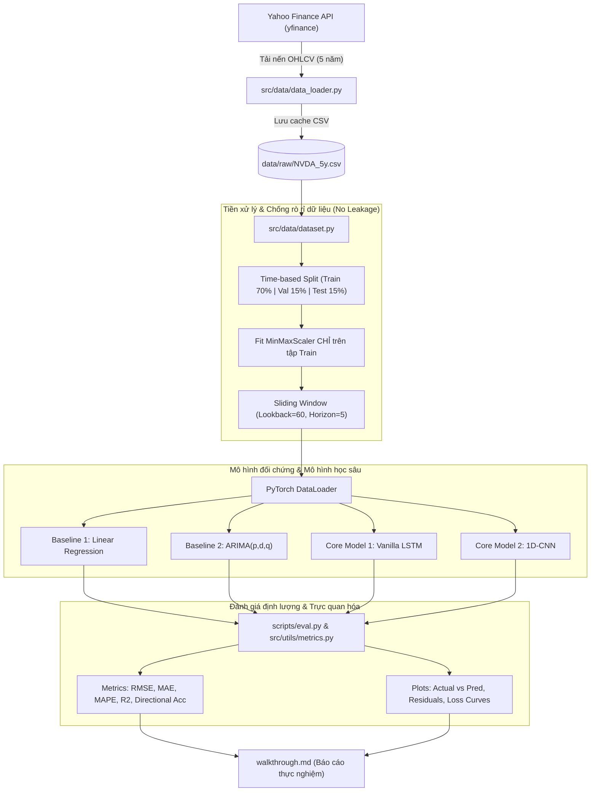

# Dự án Dự đoán Giá Cổ phiếu Đa bước (Multi-step Stock Price Forecasting) với LSTM và CNN

> **Mã cổ phiếu thực nghiệm chính**: `NVDA` (NVIDIA Corporation - Sàn NASDAQ)  
> **Bài toán**: Hồi quy chuỗi thời gian đa bước (Multi-step Time-series Regression, $k = 5$ ngày) với cửa sổ quan sát (Lookback window, $L = 60$ ngày).  
> **Mô hình**: Baseline (Linear Regression, ARIMA) vs Deep Learning (Vanilla LSTM, 1D-CNN).

---

## 1. Cấu trúc thư mục dự án (Project Directory Tree)

**Trạng thái:** Cây dưới đây mô tả cấu trúc mục tiêu. Hiện repo mới có config, tài liệu, slide và khung src/tests; các module và script huấn luyện chưa được triển khai.

```text
Stock-Forecasting/
├── .agents/                                # Quy chuẩn, kỹ năng và biểu mẫu tự động hóa
│   ├── checklists/                         # Checklists kiểm soát chất lượng
│   │   ├── new_lab_bootstrap.md            # Checklist khởi tạo cấu trúc dự án
│   │   ├── pre_commit.md                   # Checklist kiểm tra trước khi commit code
│   │   └── pre_submission.md               # Checklist nghiệm thu bài toán hồi quy
│   ├── skills/                             # 25 bộ kỹ năng kỹ thuật phần mềm (TDD, EDA, Review...)
│   └── templates/                          # Biểu mẫu báo cáo walkthrough, slide thuyết trình, README
│       ├── slide_define_design_template.md # Template slide trình bày phần bài toán và thiết kế
│       └── walkthrough_template.md         # Template báo cáo thực nghiệm sống
│
├── config/                                 # Cấu hình tập trung cho toàn bộ pipeline
│   └── default_config.yaml                 # Tham số dữ liệu, mô hình, siêu tham số huấn luyện
│
├── data/                                   # Dữ liệu chuỗi thời gian (loại trừ khỏi Git)
│   ├── raw/                                # Dữ liệu nến ngày gốc tải từ Yahoo Finance (CSV cache)
│   └── processed/                          # Dữ liệu sau chuẩn hóa (MinMaxScaler) và tạo window
│
├── docs/                                   # Sổ tay hướng dẫn chuyên sâu (Time-series, DL training, EDA)
│   ├── time_series.md                      # Hướng dẫn phân tích chuỗi thời gian & kiểm định dừng
│   ├── dl_flow.md                          # Kiến trúc luồng học sâu tổng quan
│   ├── dl_training.md                      # Quy trình huấn luyện PyTorch, loss, optimizer, scheduler
│   └── dl_data.md                          # Tiền xử lý, Custom Dataset & chống rò rỉ dữ liệu
│
├── notebooks/                              # Jupyter Notebooks phục vụ EDA và phân tích nhanh
│
├── outputs/                                # Kết quả thực nghiệm và báo cáo trực quan
│   ├── runs/                               # Lưu vết theo run_id (weights, snapshot môi trường, log)
│   └── published/                          # Biểu đồ và bảng số liệu thực tế đưa vào báo cáo
│
├── scripts/                                # Các script dòng lệnh điều phối thực thi (CLI)
│   ├── train.py                            # Huấn luyện mô hình Deep Learning (LSTM, 1D-CNN)
│   ├── eval.py                             # Đánh giá và so sánh mô hình với Baseline
│   └── predict.py                          # Dự đoán giá 5 ngày tiếp theo từ dữ liệu mới nhất
│
├── report/                                 # Bản thuyết trình slide 5 phút (Define & Design Problem)
│   ├── index.html                          # Slide HTML tương tác chạy trực tiếp trên trình duyệt
│   └── problem_definition_5min.md          # Bản slide Markdown gọn nhẹ chuẩn Marp
│
├── src/                                    # Thư viện mã nguồn module hóa tái sử dụng
│   ├── data/                               # Phân hệ nạp dữ liệu và xử lý chuỗi trượt
│   │   ├── data_loader.py                  # Tải nến OHLCV qua yfinance và lưu cache
│   │   └── dataset.py                      # Tạo Time-series Sliding Window và PyTorch DataLoader
│   ├── models/                             # Phân hệ kiến trúc mô hình
│   │   ├── baseline_lr.py                  # Baseline 1: Hồi quy tuyến tính (Linear Regression)
│   │   ├── baseline_arima.py               # Baseline 2: Mô hình thống kê ARIMA
│   │   ├── lstm_model.py                   # Mô hình chính: Vanilla LSTM đa bước
│   │   └── cnn_model.py                    # Mô hình chính: 1D-CNN trích xuất đặc trưng không gian
│   └── utils/                              # Tiện ích bổ trợ
│       ├── metrics.py                      # Tính RMSE, MAE, MAPE, R2, Directional Accuracy
│       └── visualizer.py                   # Vẽ biểu đồ Actual vs Predicted, Loss, Residuals
│
├── tests/                                  # Bộ kiểm thử tự động với PyTest
│   ├── test_data.py                        # Kiểm tra tính toàn vẹn dữ liệu và không rò rỉ (leakage)
│   └── test_models.py                      # Kiểm thử tensor shape đầu vào/đầu ra của các mô hình
│
├── .gitignore                              # Danh sách file/thư mục bỏ qua khi commit Git
├── AGENTS.md                               # Quy chuẩn kỹ thuật và chỉ dẫn nghiêm ngặt cho Agent
├── DESCRIPTION.md                          # Phiếu đăng ký đề tài chính thức
├── requirements.txt                        # Danh sách thư viện phụ thuộc Python
├── walkthrough.md                          # Tài liệu sống duy nhất theo dõi phương pháp & kết quả
└── README.md                               # Hướng dẫn tổng quan và vận hành dự án
```

---

## 2. Bảng tham chiếu các tệp cốt lõi (Key Files Reference)

Bạn có thể giữ **Ctrl + Click** vào tên tệp bên dưới để mở trực tiếp trong trình soạn thảo:

| Tệp / Đường dẫn | Phân loại | Mô tả vai trò |
| :--- | :--- | :--- |
| [walkthrough.md](./walkthrough.md) | **Tài liệu sống (Living Doc)** | Nguồn báo cáo duy nhất ghi nhận đặc tả, phương pháp, bảng số liệu thực nghiệm và đồ thị. |
| [DESCRIPTION.md](./DESCRIPTION.md) | **Đăng ký đề tài** | Phiếu mô tả mục tiêu, đối tượng sử dụng, dữ liệu và timeline 3 tuần. |
| [AGENTS.md](./AGENTS.md) | **Quy chuẩn Agent** | Bộ luật bắt buộc cho Agent: cấm rò rỉ dữ liệu (No Data Leakage), cấm bịa số liệu. |
| [config/default_config.yaml](./config/default_config.yaml) | **Cấu hình** | Quản lý tập trung thông số `ticker: NVDA`, `lookback: 60`, `horizon: 5`, batch size, learning rate. |
| [requirements.txt](./requirements.txt) | **Môi trường** | Định nghĩa phiên bản thư viện cần thiết (`torch`, `yfinance`, `statsmodels`...). |
| [.agents/checklists/new_lab_bootstrap.md](.agents/checklists/new_lab_bootstrap.md) | **Checklist** | Tiêu chuẩn dựng khung dự án ngay từ đầu. |
| [.agents/checklists/pre_commit.md](.agents/checklists/pre_commit.md) | **Checklist** | Tiêu chuẩn rà soát code và tests trước khi commit. |
| [.agents/checklists/pre_submission.md](.agents/checklists/pre_submission.md) | **Checklist** | Tiêu chuẩn kiểm toán số liệu và nghiệm thu trước khi nộp đề tài. |
| [.agents/templates/slide_define_design_template.md](.agents/templates/slide_define_design_template.md) | **Template Slide** | Khung slide 10 trang chuẩn (Marp/PowerPoint) cho phần định nghĩa bài toán & thiết kế hệ thống. |
| [report/index.html](./report/index.html) | **Slide 5 Phút (HTML)** | Bản thuyết trình HTML tương tác (chạy offline) mở trực tiếp bằng trình duyệt, có speaker notes. |
| [report/problem_definition_5min.md](./report/problem_definition_5min.md) | **Slide 5 Phút (MD)** | Bản slide Markdown gọn nhẹ chuẩn Marp cho bài thuyết trình 5 phút. |
| [.agents/skills/time-series-dl-pipeline/SKILL.md](.agents/skills/time-series-dl-pipeline/SKILL.md) | **Skill chuyên sâu** | Hướng dẫn Agent triển khai trọn vẹn pipeline chuỗi thời gian & PyTorch DL. |
| [docs/time_series.md](docs/time_series.md) | **Sổ tay kỹ thuật** | Lộ trình phân tích chuỗi thời gian, phân rã, kiểm định dừng ADF và ACF/PACF. |

---

### Trình chiếu Define & Design Problem (5 phút)

Mở [report/index.html](./report/index.html) trực tiếp trong trình duyệt, không cần kết nối mạng. Bài gồm 10 slide với tổng thời lượng gợi ý 300 giây. Dùng phím mũi tên hoặc Space để chuyển slide, `N` bật/tắt lời nói gợi ý, `F` bật/tắt toàn màn hình. Bấm **Bắt đầu** để tập với đồng hồ; **Đặt lại** để tập lại. Khi thuyết trình cho khán giả, tắt phần ghi chú. Bấm **Đọc** để xem toàn bộ nội dung và cuộn trang. Các chấm ở thanh dưới dùng để chọn slide. Phím `R` chạy lại hiệu ứng của slide hiện tại; `M` bật/tắt chuyển động. Nút **Motion: ON/OFF** hiển thị trạng thái chuyển động; hệ thống tự tắt animation nếu trình duyệt đang bật Reduce Motion. Các sơ đồ chỉ minh họa thiết kế, không phải kết quả giá hay benchmark thực tế.

Nội dung tập trung vào định nghĩa và thiết kế bài toán; các mô hình và tiêu chí đánh giá là kế hoạch nghiên cứu, chưa phải kết quả đã đạt. Báo cáo thực nghiệm chính tiếp tục được ghi trong [walkthrough.md](./walkthrough.md).

## 3. Luồng xử lý dữ liệu và huấn luyện (Pipeline Architecture)

Sơ đồ sau là thiết kế dự kiến, chưa phải pipeline đã chạy được.



---

## 4. Hướng dẫn cài đặt và vận hành

### 4.1. Khởi tạo môi trường
Dự án yêu cầu **Python $\ge 3.10$**:
```bash
pip install -r requirements.txt
```

### 4.2. Trạng thái triển khai

Các script huấn luyện, đánh giá và dự đoán cùng bộ kiểm thử hiện chưa có; repo chỉ mới có tệp khởi tạo trong `src/` và `tests/`. Không thể chạy pipeline hoặc tái lập kết quả thực nghiệm ở thời điểm này. Xem [walkthrough.md](./walkthrough.md) để theo dõi thiết kế và kết quả khi được cập nhật.

---

## 5. Tiêu chuẩn đánh giá và nghiệm thu
Dự án tuân thủ nghiêm ngặt các tiêu chí sau:
1. **Phân chia dữ liệu theo thời gian (Time-based split)**: Tuyệt đối không xáo trộn (no shuffle) để tránh Lookahead Bias.
2. **Chuẩn hóa độc lập**: Scaler chỉ học tham số `min` và `max` trên tập Train; tập Validation và Test dùng lại scaler này.
3. **Tính xác thực số liệu**: Toàn bộ chỉ số đánh giá (RMSE, MAE, MAPE, $R^2$) phải được trích xuất trực tiếp từ log thực nghiệm trong `outputs/runs/`, không dùng số liệu giả lập.
